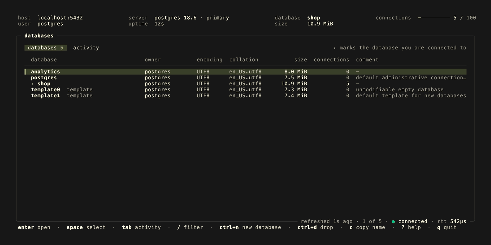
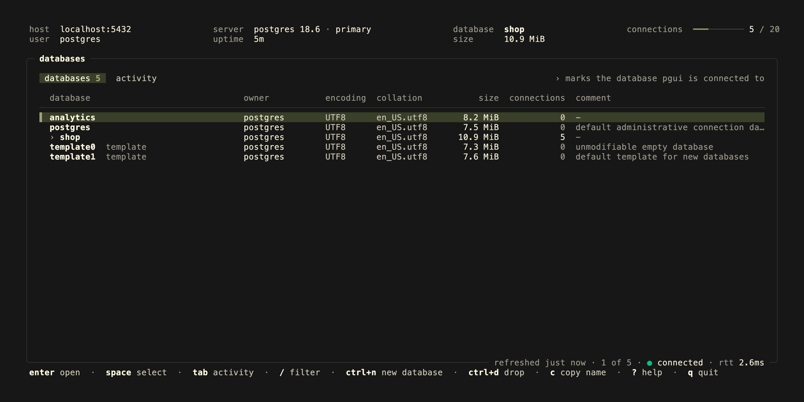
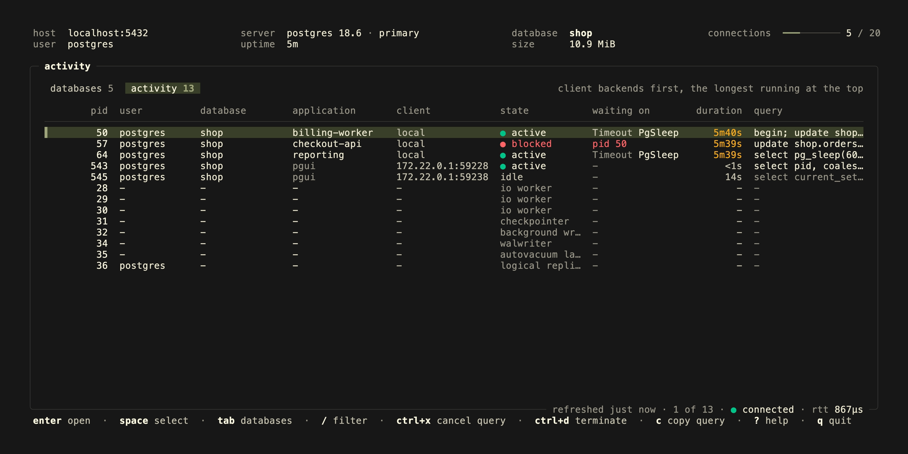
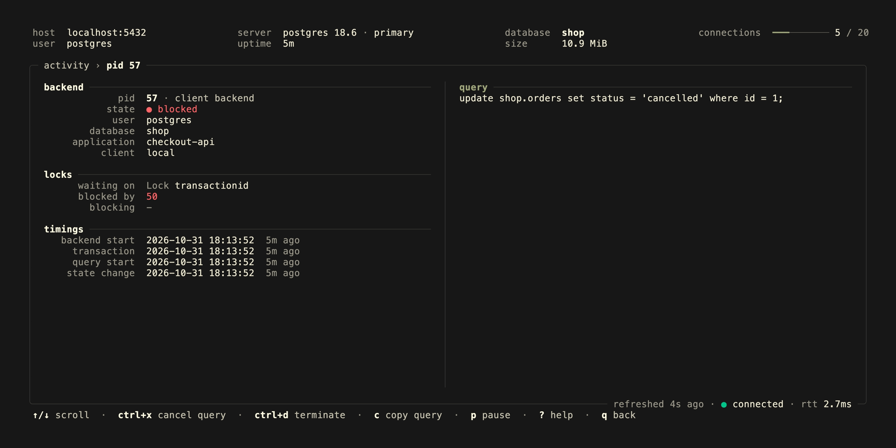
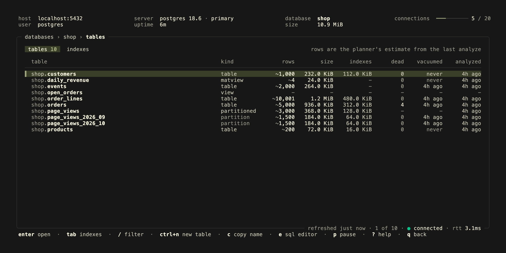
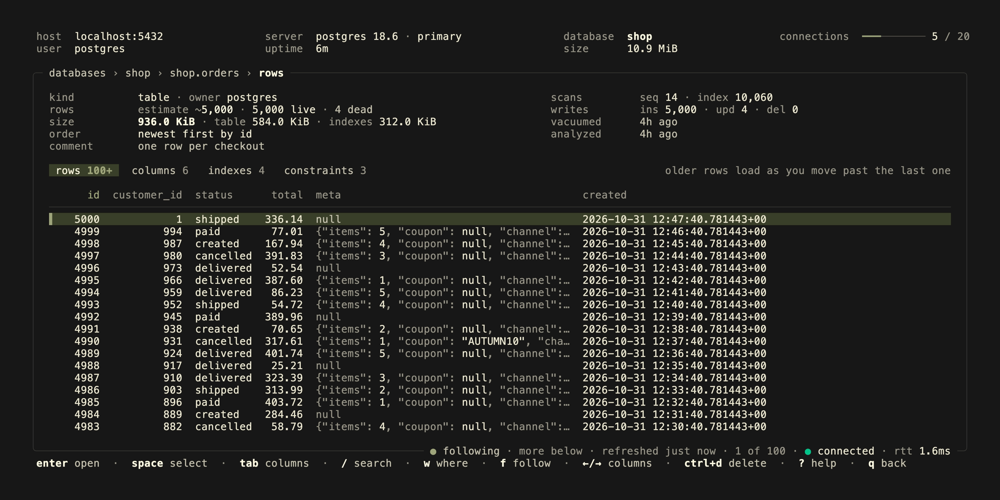
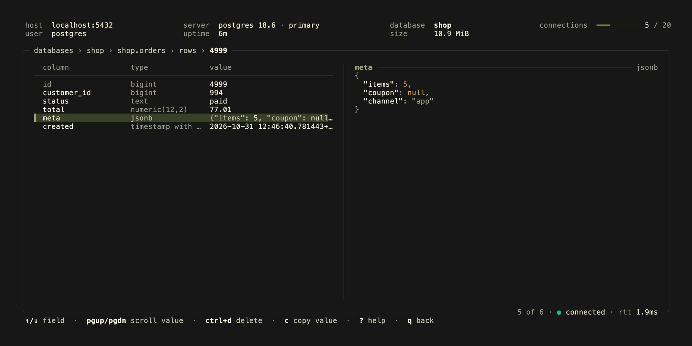
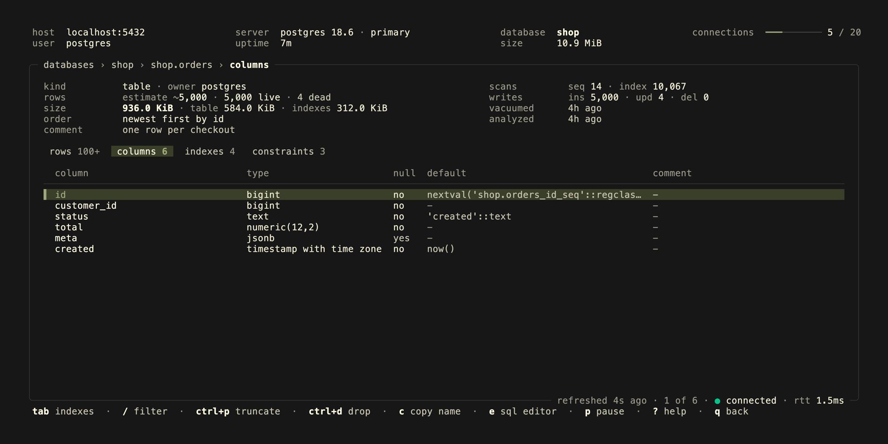
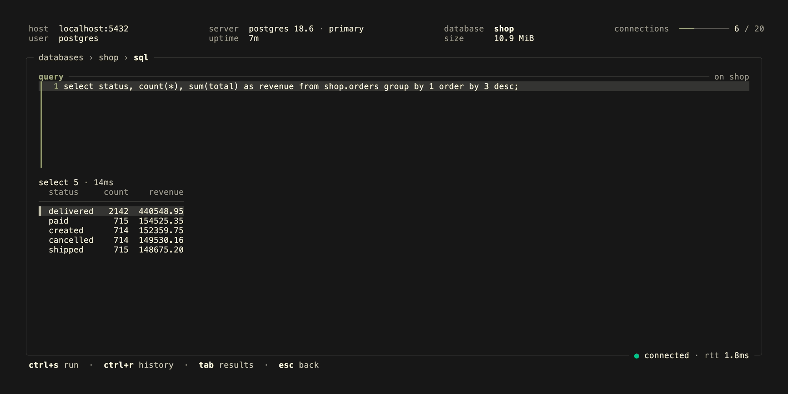

<p align="center">
  <h1 align="center">
    <a href="https://kontrolplane.dev">
      
    </a>
  </h1>
</p>

`pgui` is a terminal user interface (tui) application for managing `PostgreSQL`. It gives you a fast way to inspect and manage databases, tables, rows and sessions directly from the terminal. Page through the newest rows of a table, see which session blocks which, cancel a runaway query, run sql in an editor with its own session and drop or truncate what you no longer need.



## views

- `database`: overview with size and sessions, creation, drop
- `activity`: every session and background process, what it waits on and who it blocks, cancel its query or terminate it
- `table`: overview with estimates, sizes and vacuum stats, details with columns, indexes and constraints, drop, truncate
- `row`: the newest rows first, a `where` clause run on the server, details with pretty printed json, delete
- `sql`: an editor that runs one or more statements, with their tags, the rows of the last one and a history

The header shows the server you are connected to, its version and role, the database and its size, and how many of the allowed connections are in use.










## keybindings

- `q`: back, quit on the database overview
- `esc`: back, clear the filter or selection, cancel a dialog, form or running query; never quits
- `ctrl+c`: quit
- `↑`, `k`: up
- `↓`, `j`: down
- `→`, `l`: scroll the columns of rows right
- `←`, `h`: scroll the columns of rows left
- `g`, `G`: first/last row
- `pgup`, `pgdn`: page up/down, in a row's details scroll its value
- `tab`, `shift+tab`: switch between databases and activity, tables and indexes, rows, columns, indexes and constraints; in the editor between the query and its results
- `ctrl+n`: create database, on the tables tab open the editor with a `create table` to fill in
- `ctrl+d`: drop database/table, delete rows, terminate a session
- `ctrl+p`: truncate table
- `ctrl+x`: cancel the query of a session
- `ctrl+s`: run the query in the editor
- `ctrl+r`: the queries run in the editor this session
- `y`, `n`: answer a yes/no dialog
- `e`: open the sql editor, on a table with a query of its rows
- `w`: a `where` clause the rows of a table are loaded with
- `c`: copy database/table name, row as json, value, query or definition
- `r`: refresh, also while paused
- `p`: pause/resume the automatic refresh
- `f`: follow the newest row, or stop following
- `?`: help
- `enter`: view
- `space`: select
- `/`: filter, on the rows tab search the loaded rows

The rows tab starts with the newest 100 rows of a table, by its primary key. Moving down past the last row loads the next older page, read from where the last one ended rather than by offset, so paging stays fast deep into a table. A table without a primary key is paged by `ctid`. A view has no order to page by and is read by offset. Row values are shown as postgres writes them out, the way `psql` shows them, `null` and empty strings told apart.

The `where` clause is sent to the server as you type it, so any condition `postgres` takes works, `status = 'open' and meta->>'channel' = 'app'` included. `/` only searches the rows already loaded.

Rows are deleted by their primary key, in one transaction. A table without one refuses, delete its rows with a query instead.

The editor runs on a session of its own, kept open, so a `begin` in one run is still open in the next, and the editor says a transaction is open. It runs what you type as `psql` does with several statements on a line: each one's tag is listed, the rows of the last statement that returned rows are shown, up to 1,000 of them. `esc` while it runs cancels the query on the server.

Dropping a database or table, or truncating one, asks to type its name first. Pressing `esc` on a form with input asks again before discarding it. The database `pgui` is connected to cannot be dropped, open another one first.

While the server is unreachable, the data on screen stays and the frame says so. Changes are refused rather than queued, so nothing is done twice once it is back.

## installation

With [go](https://go.dev/) 1.26+ installed:

```bash
go install github.com/kontrolplane/pgui@latest
```

Prebuilt binaries for linux, macos and windows are attached to the [GitHub releases](https://github.com/kontrolplane/pgui/releases), together with a `checksums.txt` to verify the download.

A container image for linux/amd64 and linux/arm64 is published to `ghcr.io/kontrolplane/pgui`, tagged with the release version and `latest` for releases, and `main` for the latest commit on main:

```bash
docker run --rm -it --network host -e PGPASSWORD ghcr.io/kontrolplane/pgui:latest --host 127.0.0.1 --user postgres
```

## connecting

`pgui` connects the same way as [psql](https://www.postgresql.org/docs/current/app-psql.html). The `PG*` environment variables, the [password file](https://www.postgresql.org/docs/current/libpq-pgpass.html) and the [connection service file](https://www.postgresql.org/docs/current/libpq-pgservice.html) are read, and a flag takes the place of its environment variable. A connection string or url passed as `--dbname` takes precedence over all of them, as it does with `psql`.

| flag                 | environment variable | description                                                    |
| -------------------- | -------------------- | -------------------------------------------------------------- |
| `--dbname`, `-d`     | `PGDATABASE`         | database name, or a connection string or url                   |
| `--host`             | `PGHOST`             | server host or socket directory, defaults to `localhost`       |
| `--port`, `-p`       | `PGPORT`             | server port, defaults to `5432`                                |
| `--user`, `-U`       | `PGUSER`             | user name, defaults to the operating system user               |
| `--service`          | `PGSERVICE`          | service from `pg_service.conf`                                 |
| `--sslmode`          | `PGSSLMODE`          | `disable`, `allow`, `prefer`, `require`, `verify-ca` or `verify-full` |
|                      | `PGPASSWORD`         | password, prefer the password file                             |
| `--read-only`        |                      | start every transaction read only and refuse changes in the interface |
| `--theme`            |                      | `auto`, the default, follows the terminal; `dark` and `light` paint their own background |
| `--debug`            |                      | write debug logs to `debug.log`                                |
| `--version`          |                      | print the version and exit                                     |
| `--help`, `-h`       |                      | print the flags and exit                                       |

There is no password flag, a password on the command line is visible to other users in the process list. When the server asks for a password none was given for, `pgui` asks for it on the terminal, like `psql`. `-h` prints the help, as it does in [tsui](https://github.com/kontrolplane/tsui), so `--host` has no shorthand.

`--read-only` is a guard against mistakes, not a permission: the editor can still turn it off for its own session with `set default_transaction_read_only = off`. Connect as a role that may only read when it has to be enforced.

```bash
pgui --dbname shop
pgui --host db.internal --user app --dbname shop --sslmode verify-full
pgui --dbname "postgres://app@db.internal:5432/shop?sslmode=require"
pgui --service production --read-only
```

## development

pgui uses a local PostgreSQL server, running in Docker.

- [docker](https://www.docker.com/)
- [earthly](https://earthly.dev/)
- [vhs](https://github.com/charmbracelet/vhs) with `ffmpeg` and `ttyd`, only to record the readme gif and screenshots
- [go](https://go.dev/) 1.26+

```bash
docker compose up -d --wait
```

The project includes an [Earthfile](./Earthfile) with targets to quickly set up sample databases for development.

**create the sample databases**

```bash
earthly +seed
```

**start sessions that block each other, for the activity tab**

```bash
earthly +activity
```

**list the databases**

```bash
earthly +list
```

To show the changes made in the repository readme, the following command can be ran which automatically creates the preview gif & screenshots:

```bash
earthly +vhs
```

### running kontrolplane/pgui locally

Start PostgreSQL, create the sample databases, build and run in one go:

```bash
earthly +dev && PGPASSWORD=postgres ./build/kontrolplane/pgui --host localhost --user postgres --dbname shop
```

Seeding skips databases that already exist, so this can be rerun. The files under [seed/databases](./seed/databases) hold one database each. `psql` is used to load them when it is installed, the one in the container otherwise. Remove the `volume` directory after `docker compose down` to start from scratch.

The tests start an embedded PostgreSQL, downloaded once to `~/.embedded-postgres-go`, so they do not need Docker:

```bash
go test ./...
```

## contributors

[//]: kontrolplane/generate-contributors-list

<a href="https://github.com/levivannoort"></a>

[//]: kontrolplane/generate-contributors-list

</br>

<p align="center">
  
</p>
